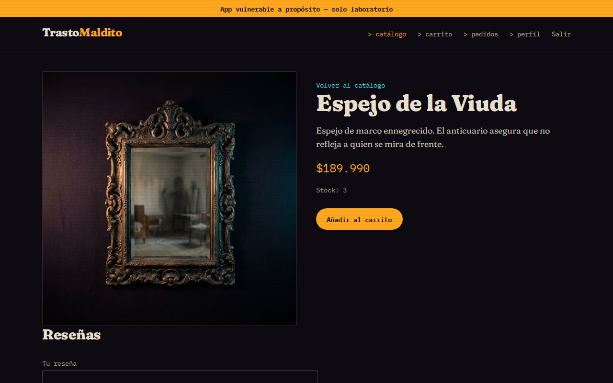
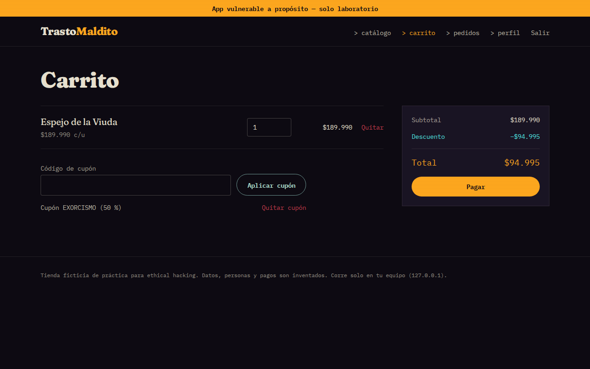
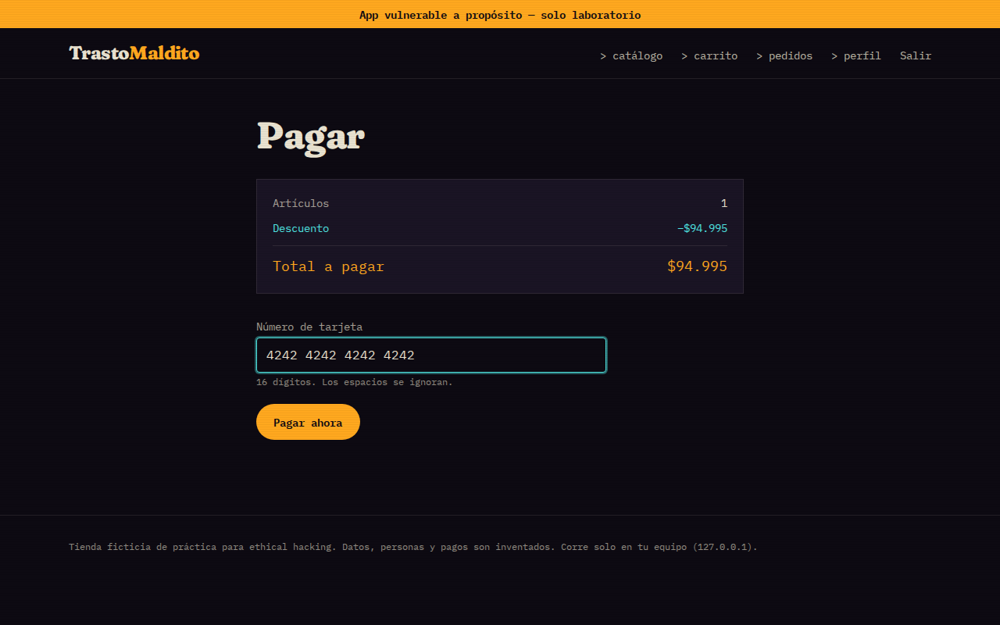
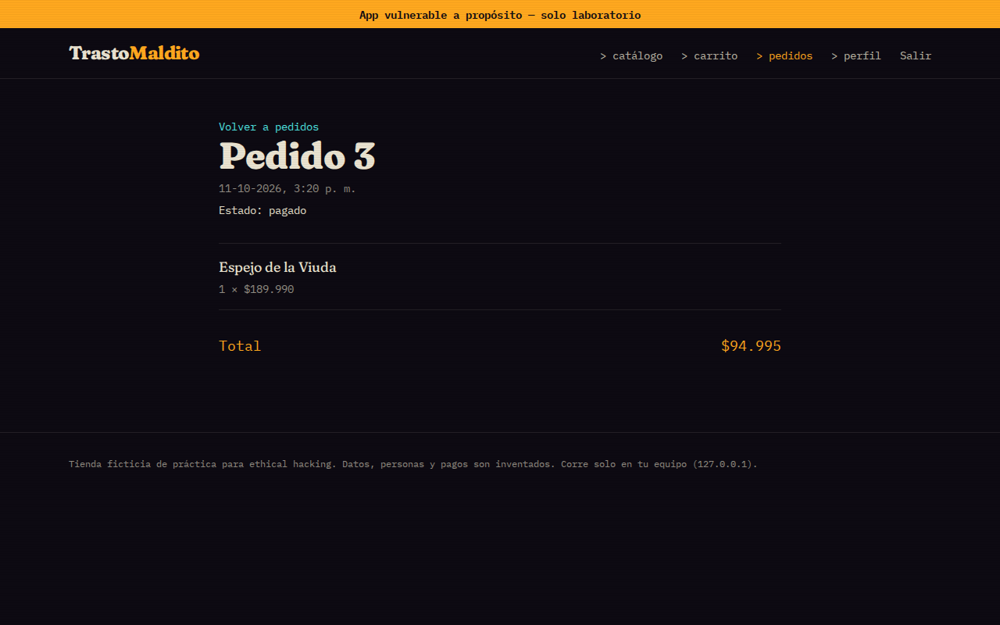
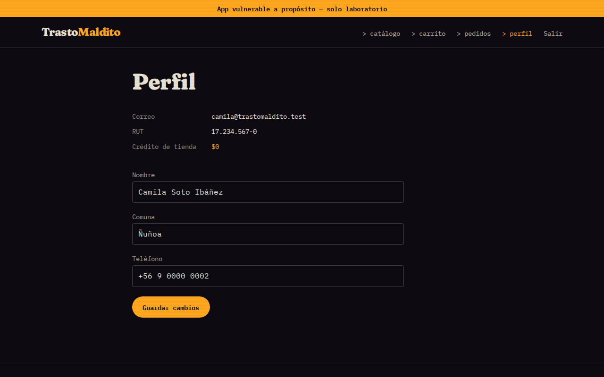
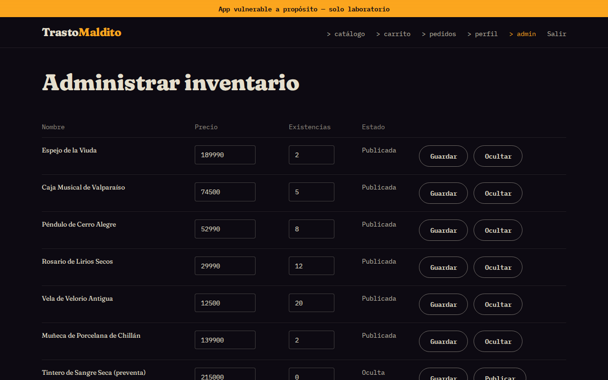

# TrastoMaldito

**English** · [Español](README.es.md)

> ⚠️ **Intentionally vulnerable app — lab use only.** It listens on `127.0.0.1` only, with 100 %
> fictional data. Never deploy it or point it at third-party systems.

An online store for paranormal objects and cursed antiques, built **with deliberate security flaws**
so you can practice web and API pentesting (in the spirit of OWASP Juice Shop, DVWA or WebGoat).
It is a lab for anyone learning ethical hacking — whether you come from a course, a bootcamp, a
postgraduate program or teach yourself: every flaw can be switched on, exploited, switched off, and
checked to confirm the fix blocks it.

## How it works

- **15 vulnerabilities**, each with an ID, a `VULN_<ID>=on|off` flag, its own file in
  `api/src/vulns/`, a teaching sheet (`fichas/`) and a spec (`specs/`). Sheets and specs are in
  Spanish.
- **Everything is `off` by default** (the healthy store). `VULN_<ID>=on` enables the flaw. Flags are
  read **once at startup**: restart the API to change one.
- Each vulnerability has a **fixed version** (`off`) and an **exploit check** that reports
  *exploited* with `on` and *blocked* with `off`. That table is the project's test harness.

## Screenshots

The healthy store (all flags `off`), with fictional data.

| | |
|---|---|
| <br>Catalog | <br>Relic page |
| <br>Cart with coupon | <br>Payment |
| <br>Paid order | <br>Profile |
| <br>Inventory admin | |

## Getting started

Requirements: Node 22+ and Python 3 (the harness only).

```bash
npm install
npm run seed
```

`npm run seed` creates `db/lab.sqlite` with fictional data (safe to repeat: it starts from scratch).
To run the API and the front end with the healthy store:

```bash
DB_PATH=db/lab.sqlite npm run dev
```

The API listens on `http://127.0.0.1:3001` (`PORT` variable) and the front end on
`http://127.0.0.1:5173`. To enable one or more vulnerabilities, set their flags at startup:

```bash
DB_PATH=db/lab.sqlite VULN_W1=on VULN_A07=on npm run dev
```

The lab accounts (admin and two customers) are in `db/fixtures.json`; their passwords are fake and
say so. Images uploaded by the admin go to `UPLOAD_DIR` (default `./uploads`).

## The vulnerabilities

The store flow where each one lives and its OWASP category. The details of each flaw, its fix and
how to practice it are in its sheet (Spanish).

| ID | OWASP category | Store flow | Sheet |
|---|---|---|---|
| `W1` | A05:2025 Injection | Catalog search | [W1](fichas/W1.md) |
| `W2` | A05:2025 Injection | Relic reviews | [W2](fichas/W2.md) |
| `W3` | A02:2025 Security Misconfiguration | API errors | [W3](fichas/W3.md) |
| `W4` | A04:2025 Cryptographic Failures | Account passwords | [W4](fichas/W4.md) |
| `W5` | A06:2025 Insecure Design | "Exorcism −50 %" coupon | [W5](fichas/W5.md) |
| `W6` | A10:2025 Mishandling of Exceptional Conditions | Payment and order status | [W6](fichas/W6.md) |
| `A07` | A07:2025 Authentication Failures | Login | [A07](fichas/A07.md) |
| `A09` | A09:2025 Security Logging & Alerting Failures | Auth and checkout | [A09](fichas/A09.md) |
| `A1` | API1:2023 Broken Object Level Authorization | Customer orders | [A1](fichas/A1.md) |
| `A2` | API2:2023 Broken Authentication | Token session | [A2](fichas/A2.md) |
| `A3` | API3:2023 Broken Object Property Level Authorization | Customer profile | [A3](fichas/A3.md) |
| `API4` | API4:2023 Unrestricted Resource Consumption | Catalog list | [API4](fichas/API4.md) |
| `API5` | API5:2023 Broken Function Level Authorization | Admin inventory | [API5](fichas/API5.md) |
| `A4` | API9:2023 Improper Inventory Management | API versions | [A4](fichas/A4.md) |
| `A5` | API7:2023 SSRF (A01:2025) | Relic image from URL | [A5](fichas/A5.md) |

> IDs are lab labels, not the OWASP category number (e.g. `A4` is API9, `API4` is API4). The flag
> always uses the ID from the table.

## The harness: the on/off table

For every ID and mode, `exploits/run.py` starts a fresh API on a clean copy of the database and a
free port, runs the check `exploits/test_<id>.py`, and shuts the API down. A row passes when `on` is
exploited and `off` is blocked. A check that could not run counts as ❌, never as green.

```bash
python3 -m venv .venv && .venv/bin/pip install -r exploits/requirements.txt
npm run exploits
```

For one or several vulns: `.venv/bin/python exploits/run.py --only W1,A07`. The rest of the tests:

```bash
npm run typecheck                 # types (api and front)
npm test                          # vitest for the API and the front end
.venv/bin/python -m pytest exploits/test_runner.py   # tests of the runner itself
npx playwright install chromium   # once
npm run e2e                       # E2E smoke: sign-up, search, cart, coupon, payment, order
```

## Layout

```
api/src/            healthy store (Fastify + TypeScript + SQLite)
api/src/vulns/      one file per vulnerability: its single `if (flags.<ID>)` lives there
api/src/flags.ts    reads VULN_<ID> once at startup
front/              storefront (React + Vite + Tailwind)
db/                 schema.sql, fixtures.json (fictional data) and seed.ts
exploits/           run.py (the harness) and one test_<id>.py per vulnerability
e2e/                Playwright E2E smoke test
specs/  fichas/     spec and teaching sheet of each vulnerability (Spanish)
docs/               screenshots and known limitations (DEUDAS.md, Spanish)
```

## Environment variables

| Variable | What it does |
|---|---|
| `DB_PATH` | SQLite path used by the API (required to get a store; without it only `/health` answers) |
| `PORT` | API port (default 3001) |
| `UPLOAD_DIR` | Folder for uploaded images (default `./uploads`) |
| `JWT_SECRET` | Token secret (default: random per start; `A2` weakens it) |
| `VULN_<ID>` | `on` or `off`; any other value aborts startup |

The host is not configurable: `127.0.0.1` is fixed in the code.

## Responsible use

This app is vulnerable **on purpose**. Run it only on your own machine (that is why it listens on
`127.0.0.1` only) and never expose it to the internet. The techniques you practice here may only be
used against systems you own or have written authorization to test.

## How it is built

Each flaw lives only in its module and exists only with its flag on; the healthy store is the
reference every vulnerability is measured against. Known limitations of the harness are listed in
[docs/DEUDAS.md](docs/DEUDAS.md) (Spanish).

## License

[MIT](LICENSE). No warranty of any kind.
